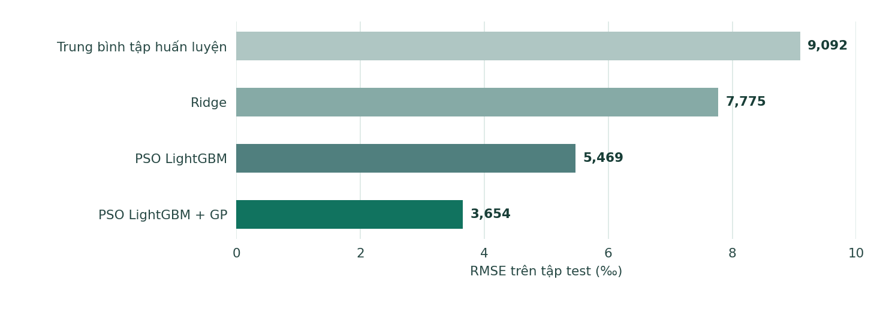

# Dự báo độ mặn từ ảnh Landsat 8 bằng mô hình cây và Gaussian Process

**Vai trò của tôi** · Xây dựng mô hình và thiết kế đánh giá.

Tôi dùng đặc trưng ảnh Landsat 8, địa hình và ngày quan trắc để ước lượng độ mặn tại từng điểm lấy mẫu. Trên **151 quan trắc thuộc 7 ngày** từ tháng 3 đến tháng 6/2020, hiệu chỉnh phần dư bằng Gaussian Process (GP) giúp PSO LightGBM giảm **33,2% RMSE**, từ **5,469 ‰** xuống **3,654 ‰**.

[Thử demo mô phỏng](https://hanmtien22.github.io/BMA_Predict_Salinity/) · [Xem phương pháp](#phương-pháp) · [Mở notebook huấn luyện](notebooks/salinity-predict.ipynb) · [Chạy dự báo CSV](docs/inference.md)

## Kết quả trên những ngày quan trắc giữ lại

| Mô hình | RMSE (‰) ↓ | MAE (‰) ↓ | R² ↑ |
| --- | ---: | ---: | ---: |
| Trung bình tập huấn luyện | 9,092 | 6,398 | −0,148 |
| Ridge | 7,775 | 5,700 | 0,160 |
| PSO LightGBM | 5,469 | 3,932 | 0,585 |
| **PSO LightGBM + GP** | **3,654** | **2,739** | **0,815** |

Cả bốn dòng dùng cùng 151 quan trắc. Hai dòng cuối dùng cùng mô hình cây đã fit, nên chênh lệch **1,815 ‰** đo trực tiếp thay đổi khi thêm GP. Tôi dùng RMSE để nhìn rõ tác động của các sai số lớn và báo cáo thêm MAE để người đọc biết độ lệch tuyệt đối trung bình. Số liệu lấy từ bảng đánh giá của bộ model đã lưu.

## Phương pháp

1. **Giữ nguyên thứ tự thời gian.** Tập huấn luyện gồm 359 quan trắc trước 01/03/2020. Tôi giữ nguyên từng ngày quan trắc khi chia tập để các mẫu thu cùng ngày không xuất hiện ở cả hai phía của một lần chia. Bảy ngày test trải từ 10/03 đến 14/06/2020.
2. **Tạo dự báo ngoài fold (OOF).** Trong mỗi fold ngoài, PSO chọn siêu tham số bằng các fold tiến theo thời gian bên trong phần lịch sử. Cây dự báo cho khối ngày kế tiếp. Sau giai đoạn khởi tạo, 288 mẫu có dự báo OOF. Các điểm `Base_CV` trong notebook đánh giá mô hình nền ở bước này.
3. **Học phần sai số còn lại.** GP học chênh lệch giữa độ mặn thực đo và dự báo OOF của cây từ thời gian, chu kỳ năm và vị trí. Với ngày mới, pipeline cộng hiệu chỉnh của GP vào dự báo cây và chặn kết quả ở mức tối thiểu 0 ‰. Bảng trên chấm toàn bộ pipeline trên tập test.

**Giới hạn.** Bảy ngày test cung cấp bằng chứng cho giai đoạn đã quan trắc. Khả năng chuyển sang vùng hoặc mùa khác cần dữ liệu kiểm định độc lập. CSV đầu vào đã chứa các chỉ số và thành phần chính PCA. Phạm vi kiểm soát rò rỉ trong notebook bắt đầu từ bảng đặc trưng này. [Xem cách khảo sát phần dư theo khoảng cách và độ trễ](notebooks/oof_residual_diagnostics_kaggle.ipynb)

## Chạy thử và tái lập

| Bạn muốn làm gì? | Cách chạy |
| --- | --- |
| Thử tương tác ngay trên trình duyệt | [Mở demo](https://hanmtien22.github.io/BMA_Predict_Salinity/), đổi ngày, NDVI và NDWI. Demo dùng hồi quy huấn luyện trên dữ liệu tổng hợp với seed cố định. |
| Kiểm tra mã từ bản clone sạch | Dùng Python 3.12, cài `python -m pip install -r requirements.txt`, rồi chạy `python -m unittest discover -s tests -v`. Chạy `node --test tests/demo.test.mjs` để kiểm tra demo. |
| Dự báo CSV hoặc đối chiếu với notebook | [Hướng dẫn CLI và kiểm thử riêng](docs/inference.md). Bước này cần bộ model riêng. Phép đối chiếu dùng thêm CSV gốc và dự báo tham chiếu. |
| Huấn luyện và đọc chẩn đoán | [Notebook huấn luyện](notebooks/salinity-predict.ipynb) và [notebook phần dư](notebooks/oof_residual_diagnostics_kaggle.ipynb) ghi rõ dữ liệu riêng cần cấp và cách đọc kết quả. |

Khi kiểm tra bản phát hành, CLI được đối chiếu trên **7 mô hình × 151 dòng** với dung sai tuyệt đối **0,000001 ‰**. CI công khai dùng dữ liệu nhân tạo và kiểm tra khả năng tái tạo mô hình demo.
